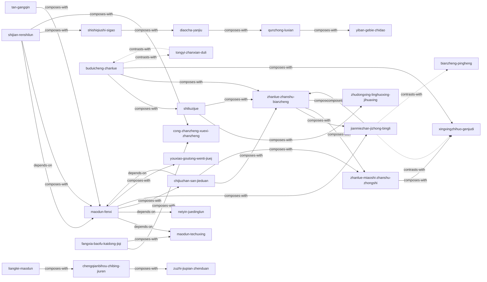

# 毛泽东选集第1-5卷 — Skill Index

> 本书由 book2skill 蒸馏, 共产出 **25** 个 skills。
> 处理时间: 2026-05-02

## 关于这本书

- **作者**: 毛泽东
- **出版年**: 1951-1977 (各卷陆续出版)
- **一句话主旨**: 以矛盾分析法为核心的"认知世界—分析问题—制定策略—执行落地"全链条方法论体系
- **整书理解**: 见 [BOOK_OVERVIEW.md](./BOOK_OVERVIEW.md)

---

## Skill 列表 (按主题分组)

### 认知与认识论

- [`shijian-renshilun`](./shijian-renshilun/SKILL.md) — 实践-认识-再实践的螺旋认知循环
- [`shishiqiushi-sigao`](./shishiqiushi-sigao/SKILL.md) — 去粗取精、去伪存真、由此及彼、由表及里的信息加工四步法
- [`maodun-fenxi`](./maodun-fenxi/SKILL.md) — 从多个矛盾中找到主要矛盾的瓶颈识别法
- [`maodun-techuxing`](./maodun-techuxing/SKILL.md) — 不同性质的问题用不同方法，反教条主义的方法论适配框架
- [`neiyin-juedinglun`](./neiyin-juedinglun/SKILL.md) — 外因通过内因起作用的归因优先级框架

### 调查与信息获取

- [`diaocha-yanjiu`](./diaocha-yanjiu/SKILL.md) — 没有调查就没有发言权的一手信息采集方法论
- [`qunzhong-luxian`](./qunzhong-luxian/SKILL.md) — 从群众中来到群众中去的用户洞察无限循环

### 竞争战略

- [`chijiuzhan-san-jieduan`](./chijiuzhan-san-jieduan/SKILL.md) — 防御→相持→反攻的以弱胜强三阶段模型
- [`buduicheng-zhanlue`](./buduicheng-zhanlue/SKILL.md) — 弱者重新定义竞争范式的升维战略
- [`xingxingzhihuo-genjudi`](./xingxingzhihuo-genjudi/SKILL.md) — 边缘突破→根据地建设→波浪式扩张的路径规划
- [`jianmiezhan-jizhong-bingli`](./jianmiezhan-jizhong-bingli/SKILL.md) — 在关键局部集中绝对优势兵力的聚焦突破法
- [`shiliuzijue`](./shiliuzijue/SKILL.md) — 敌进我退、敌驻我扰、敌疲我打、敌退我追的竞争节奏四步法
- [`zhanlue-zhanshu-bianzheng`](./zhanlue-zhanshu-bianzheng/SKILL.md) — 宏观被动中制造微观主动的攻守辩证法

### 心态与行动哲学

- [`zhanlue-miaoshi-zhanshu-zhongshi`](./zhanlue-miaoshi-zhanshu-zhongshi/SKILL.md) — 战略上藐视困难、战术上重视困难的双层心态管理
- [`cong-zhanzheng-xuexi-zhanzheng`](./cong-zhanzheng-xuexi-zhanzheng/SKILL.md) — 行动优先、干起来再学习的行动哲学
- [`fangxia-baofu-kaidong-jiqi`](./fangxia-baofu-kaidong-jiqi/SKILL.md) — 卸掉认知包袱 + 主动深度思考的认知重启框架
- [`zhudongxing-linghuoxing-jihuaxing`](./zhudongxing-linghuoxing-jihuaxing/SKILL.md) — 主动性、灵活性、计划性的执行力三要素平衡

### 组织与管理

- [`lianglei-maodun`](./lianglei-maodun/SKILL.md) — 对抗性vs非对抗性冲突的区分与分级响应
- [`chengqianbihou-zhibing-jiuren`](./chengqianbihou-zhibing-jiuren/SKILL.md) — 不讲情面揭发错误 + 完全为了救人的建设性纠偏方法
- [`zuzhi-jiupian-zhenduan`](./zuzhi-jiupian-zhenduan/SKILL.md) — 表现→根源→处方的组织健康度诊断三步法
- [`yiban-gebie-zhidao`](./yiban-gebie-zhidao/SKILL.md) — 先试点再推广的双螺旋验证-推行模型
- [`tongyi-zhanxian-duli`](./tongyi-zhanxian-duli/SKILL.md) — 合作中保持独立立场的博弈框架
- [`tan-gangqin`](./tan-gangqin/SKILL.md) — 中心工作与全面配合的多任务节奏管理
- [`bianzheng-pingheng`](./bianzheng-pingheng/SKILL.md) — 多目标动态平衡而非零和取舍的思维模型
- [`youxiao-goutong-wenti-jiuej`](./youxiao-goutong-wenti-jiuej/SKILL.md) — 反八股清单 + 观察提出分析解决四步法

---

## 引用图



图例:
- `-->`  depends-on
- `-.->` contrasts-with
- `===>` composes-with

---

## 推荐学习顺序

(从依赖图的叶子节点开始, 向上)

1. **shijian-renshilun** (实践认识论) — 最基础的认知哲学, 没有前置要求
2. **shishiqiushi-sigao** (实事求是信息加工法) — 依赖实践认识论, 信息加工的具体技术
3. **diaocha-yanjiu** (调查研究法) — 依赖实事求是, 一手信息采集方法
4. **cong-zhanzheng-xuexi-zhanzheng** (在战争中学习战争) — 依赖实践认识论, 行动优先的操作策略
5. **fangxia-baofu-kaidong-jiqi** (放下包袱开动机器) — 与"在战争中学习战争"互补, 认知清空与重建
6. **maodun-fenxi** (矛盾分析法) — 依赖实践认识论, 核心分析框架
7. **maodun-techuxing** (矛盾特殊性原则) — 依赖矛盾分析法, 方法论适配
8. **neiyin-juedinglun** (内因决定论) — 依赖矛盾分析法, 归因框架
9. **qunzhong-luxian** (群众路线) — 依赖调查研究, 持续的用户洞察循环
10. **youxiao-goutong-wenti-jiuej** (有效沟通与问题解决) — 依赖矛盾分析法, 沟通与表达框架
11. **xingxingzhihuo-genjudi** (星星之火根据地) — 早期扩张路径, 可在矛盾分析后学习
12. **buduicheng-zhanlue** (不对称战略) — 弱者竞争范式, 与根据地建设互补
13. **chijiuzhan-san-jieduan** (三阶段持久战) — 依赖矛盾分析法, 长期竞争时间规划
14. **jianmiezhan-jizhong-bingli** (集中优势兵力) — 依赖矛盾分析法, 聚焦突破的资源策略
15. **shiliuzijue** (十六字诀) — 依赖不对称战略, 竞争节奏的执行步骤
16. **zhanlue-zhanshu-bianzheng** (战略战术辩证法) — 综合战略层, 连接上述多个战略skill
17. **zhanlue-miaoshi-zhanshu-zhongshi** (战略藐视战术重视) — 与战略战术辩证法互补, 心态管理
18. **zhudongxing-linghuoxing-jihuaxing** (主动性灵活性计划性) — 执行力三要素, 配合战术执行
19. **tongyi-zhanxian-duli** (统一战线独立自主) — 合作博弈框架, 与不对称战略对比学习
20. **bianzheng-pingheng** (辩证平衡) — 多目标管理, 与集中兵力对比学习
21. **yiban-gebie-zhidao** (一般号召与个别指导) — 依赖群众路线, 战略推行方法
22. **tan-gangqin** (弹钢琴工作法) — 多任务节奏管理, 配合矛盾分析法确定中心工作
23. **lianglei-maodun** (两类矛盾分类处理) — 组织冲突的分类与化解
24. **chengqianbihou-zhibing-jiuren** (惩前毖后治病救人) — 依赖两类矛盾, 建设性纠偏方法
25. **zuzhi-jiupian-zhenduan** (组织纠偏诊断模型) — 与惩前毖后互补, 组织诊断的系统方法

---

## 接入 darwin-skill

所有 skill 均带有 `test-prompts.json` (darwin-skill 兼容格式), 可直接接入自动进化:

```
darwin evolve books/mao-selected-works/
```

---

## 审计轨迹

- 候选单元池: [candidates/](./candidates/)
- 被淘汰的候选 (含原因): [rejected/](./rejected/)
- BOOK_OVERVIEW: [BOOK_OVERVIEW.md](./BOOK_OVERVIEW.md)
